# Module 1 · Lab 2 — Apache Log Analysis with CLI Tools

**Module:** 1 · **Level:** beginner to intermediate · **Estimated time:** 2–3 hours

## Scenario

You are a SOC analyst reviewing a fictional web server's Apache access log. Use offline command-line analysis to identify traffic patterns, errors, scanning indicators, and possible web attack payloads.

## Learning outcomes

- Parse Apache Combined Log Format with `awk`.
- Count requests, unique clients, status codes, and requested paths.
- Use `grep` safely for bounded pattern matching.
- Explain why an indicator is a lead rather than proof of compromise.
- Produce a reproducible security analysis report.

## Prerequisites

- Linux, WSL, or another environment with Bash and standard POSIX tools.
- Basic understanding of Apache access-log fields.
- No network access is required.

## Contents

- [`data/apache-access.log`](data/apache-access.log) — synthetic log records
- [`tools/analyze-apache-log.sh`](tools/analyze-apache-log.sh) — offline analyzer
- [`tools/run-cli-lab.sh`](tools/run-cli-lab.sh) — complete exercise runner using `grep`, `awk`, `sed`, `cut`, `sort`, and `uniq`
- [`reports/LOG-ANALYSIS-REPORT-TEMPLATE.md`](reports/LOG-ANALYSIS-REPORT-TEMPLATE.md) — report template
- [`reports/LAB-2-COMPLETION-REPORT.md`](reports/LAB-2-COMPLETION-REPORT.md) — completed exercise findings
- [`reports/LOG-ANALYSIS-KALI-EVIDENCE-REPORT.docx`](reports/LOG-ANALYSIS-KALI-EVIDENCE-REPORT.docx) — Kali Linux VM execution evidence report
- [`artifacts/analysis-output-example.md`](artifacts/analysis-output-example.md) — reproducible text evidence from the analyzer
- [`artifacts/README.md`](artifacts/README.md) — expected analyst deliverables
- [`screenshots/README.md`](screenshots/README.md) — safe Kali evidence capture guide
- [`screenshots/`](screenshots/) — Kali VM command-output evidence images

GitHub does not preview DOCX files in the browser. Open the linked report from the `reports` folder and download it, then view it in Microsoft Word or another DOCX-compatible editor.

## Exercises

1. Count total requests with `wc -l`.
2. Extract and count unique IP addresses.
3. Find the top request sources.
4. Count status codes and identify 404 paths.
5. Review Nikto, SQL injection, XSS, and directory-traversal indicators.
6. Analyze request methods and traffic by hour.
7. Anonymize addresses before including command output in a public report.
8. Complete the report template and explain benign alternatives.

Run the analyzer:

```bash
./tools/analyze-apache-log.sh data/apache-access.log artifacts
```

The script reads only the supplied file and writes local text artifacts. It does not make network connections or block addresses.

Run the complete exercise locally:

```bash
./tools/run-cli-lab.sh data/apache-access.log artifacts
```

This runner covers the supplied exercise sequence, including basic counts, top talkers, status codes, 404 paths, Nikto, SQL-like, XSS-like, and traversal-like patterns, traffic by hour, HTTP methods, `sed`, `cut`, and anonymized reporting.

See the [completed exercise report](reports/LAB-2-COMPLETION-REPORT.md) for the observed results and security interpretation. The optional `wget` example from the source material is intentionally not used; the lab remains offline and uses the bundled synthetic log.

## Evidence and reporting

The `kali-*.png` images are real captures from the Kali Linux VirtualBox VM. They contain no real host, account, credential, or external target.

### Kali Linux VM evidence

| Exercise | Evidence |
|---|---|
| Kali environment and workspace setup | 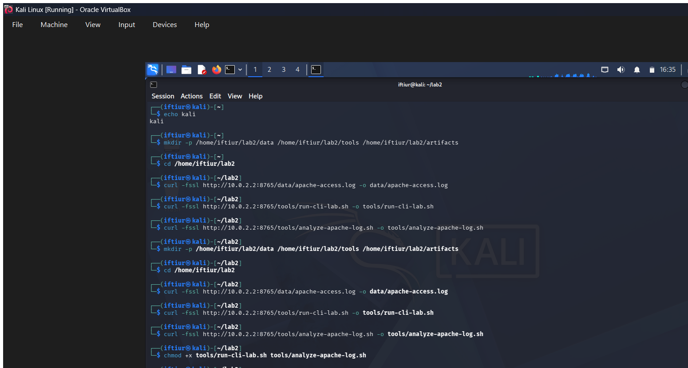 |
| View the Apache log sample | 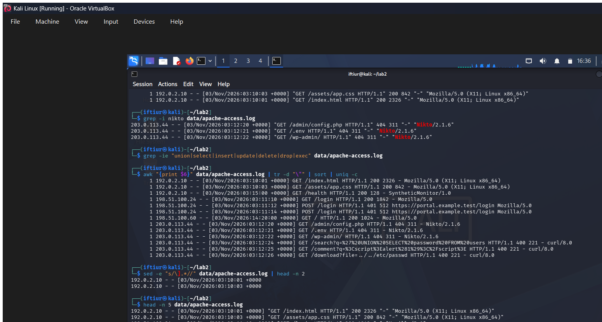 |
| Count requests | 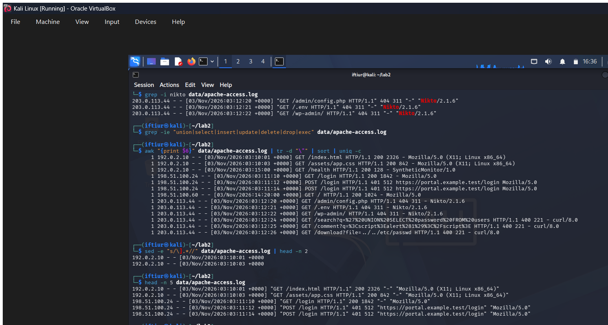 |
| Review status codes | 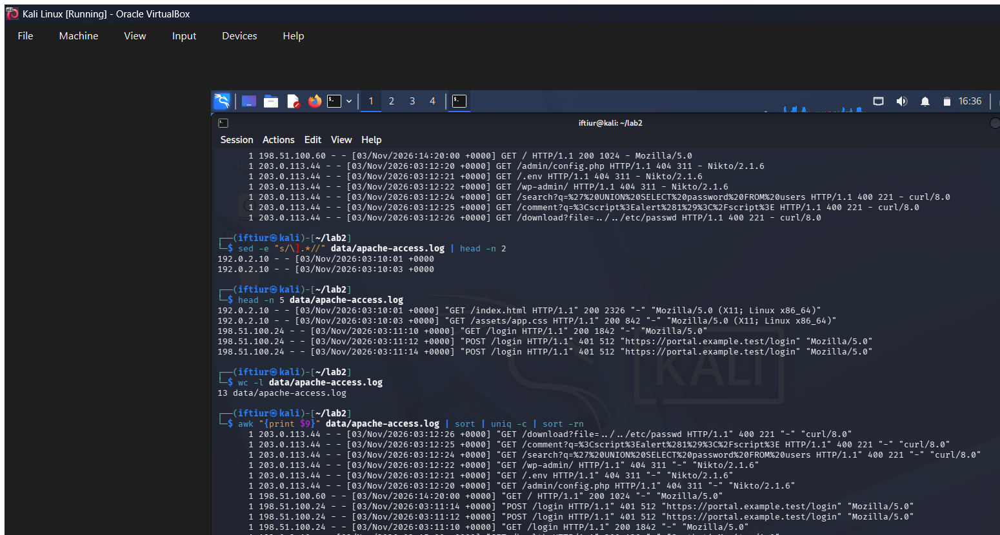 |
| Search for Nikto activity | 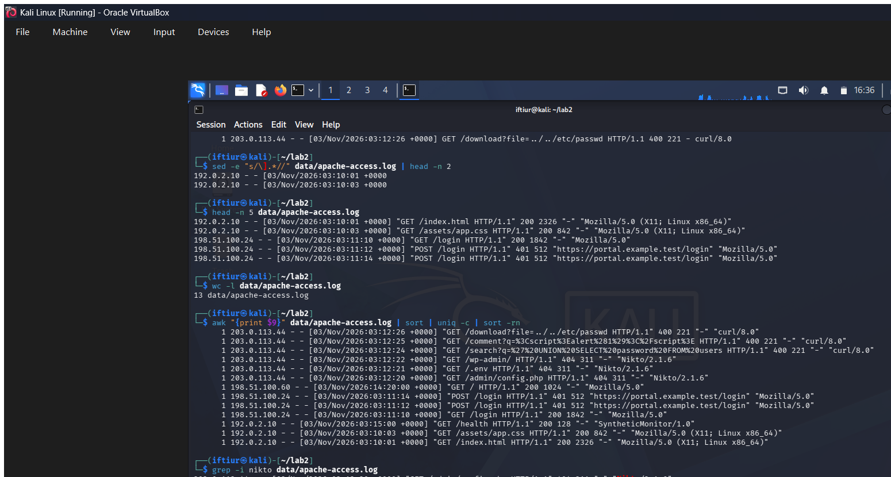 |
| Search for SQL-like indicators | 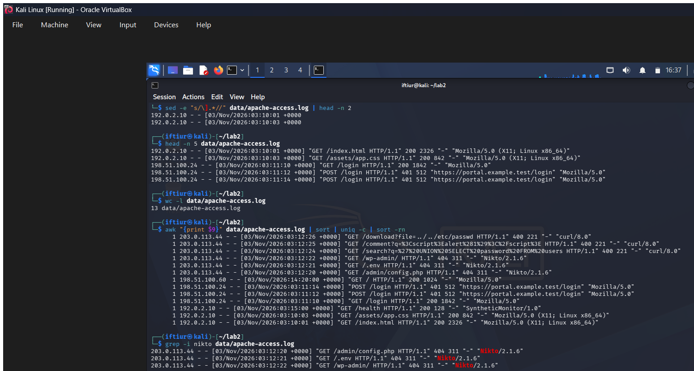 |
| Count HTTP methods | 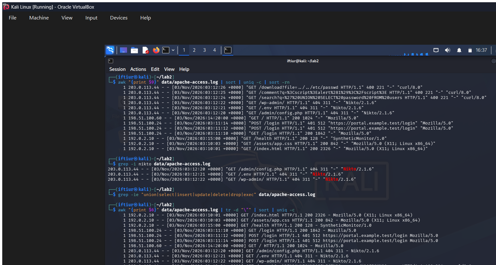 |
| Review timestamps with `sed` | 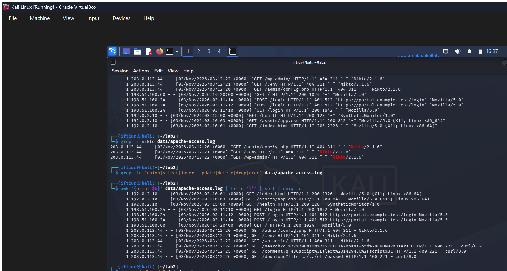 |
| Extract fields with `cut` | 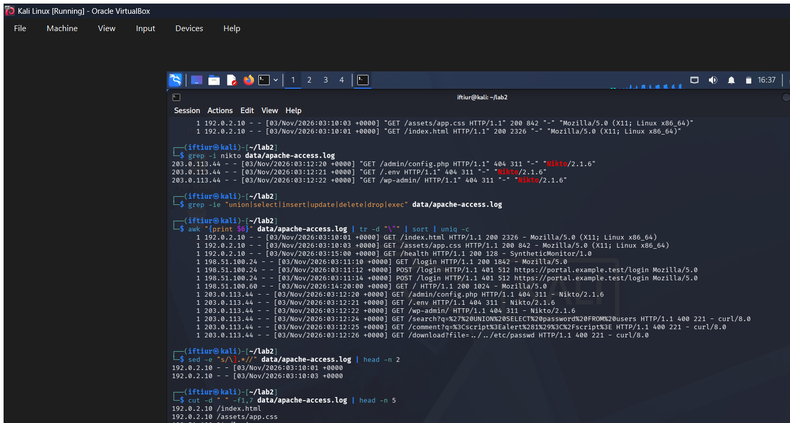 |
| Run the complete exercise | 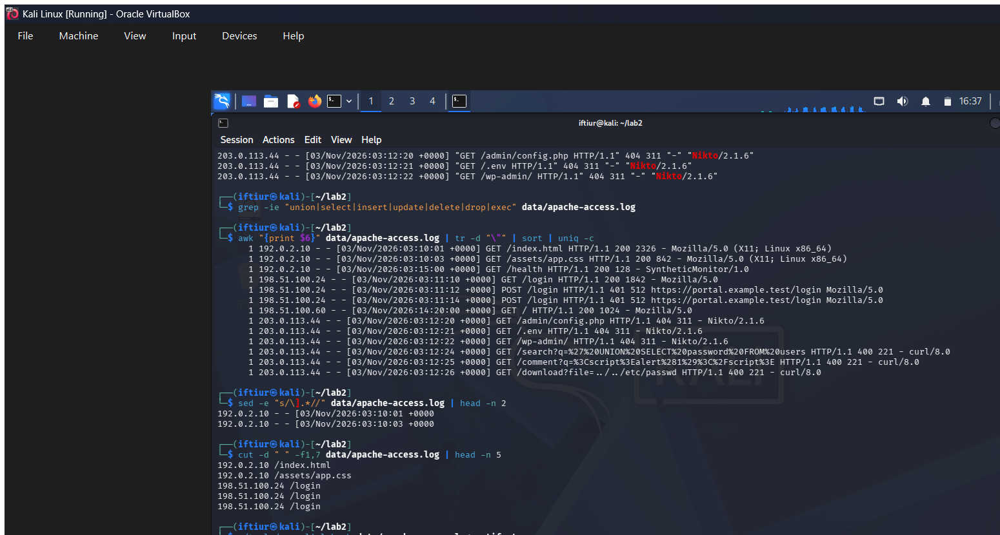 |
| Review the generated report | 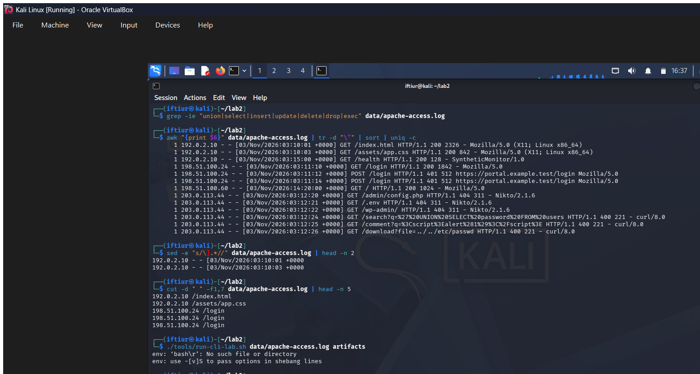 |

Review the [analysis output example](artifacts/analysis-output-example.md) alongside these images, then complete the [log-analysis report template](reports/LOG-ANALYSIS-REPORT-TEMPLATE.md). The [screenshot guide](screenshots/README.md) documents how the evidence was captured and what must be excluded from future screenshots.

## Safety

The sample uses documentation-only addresses and fictional names. Never publish real logs, credentials, cookies, tokens, internal hostnames, or customer data. A suspicious path or user agent is an investigative lead, not proof of compromise.
